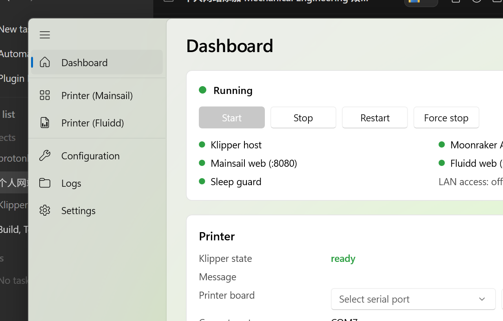
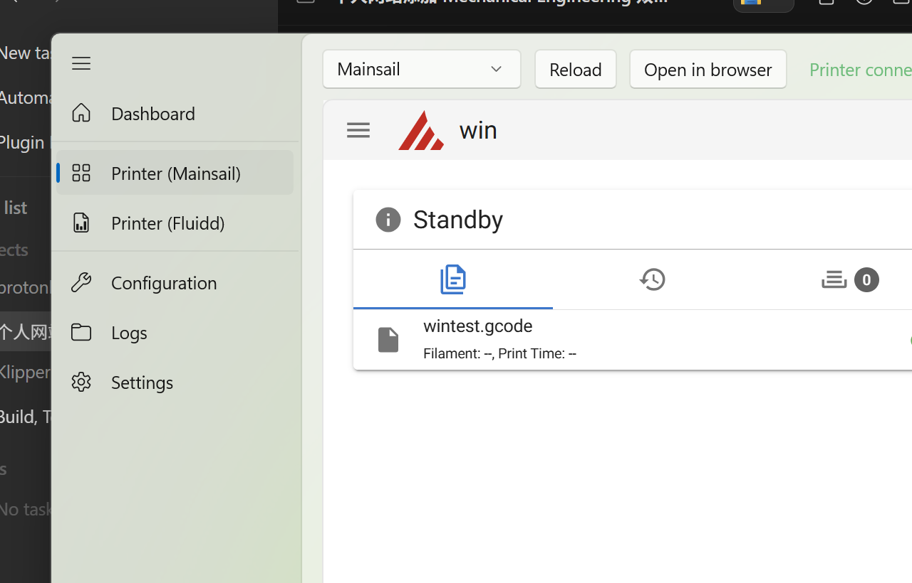
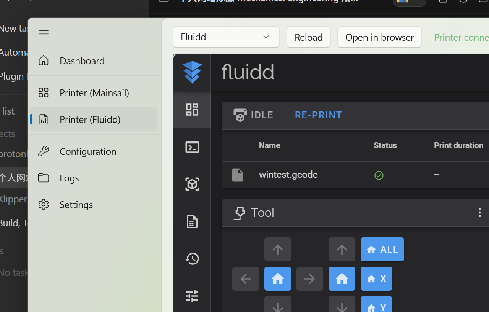

# Klipper for Windows

Run [Klipper](https://www.klipper3d.org) natively on Windows — like it were
the Raspberry Pi: plug your printer board into USB and the PC becomes the
host. **No Linux VM, no WSL, no fork** — Klipper, Moonraker, Mainsail and
Fluidd are pristine upstream at pinned versions, and Windows support lives
entirely in a small compatibility layer (patch files + C shim headers +
a generated `sitecustomize.py`).

A native **WinUI 3** app wraps everything: light theme, English, one
window to start/stop the stack, pick your serial port, edit configs, and
use Mainsail or Fluidd embedded with one click.



| Mainsail embedded | Fluidd embedded |
|---|---|
|  |  |

## Requirements

- Windows 10 19041+ / Windows 11
- [Python](https://python.org) 3.10+ (on PATH)
- [Git for Windows](https://git-scm.com)
- zig (`winget install zig.zig`) — compiles Klipper's C helper
- WebView2 Runtime (preinstalled on Windows 11)

## Quick start

```powershell
# one-time: fetch pinned components, build the venv + C helper, verify
python -m klipperforwindows setup

# plug in your printer board, then pick the port (writes printer.cfg)
python -m klipperforwindows serial --auto

# start everything (klipper, moonraker, mainsail :8080, fluidd :8081)
python -m klipperforwindows up
```

Or skip the console entirely: build/open the GUI
(`app/KlipperForWindows/KlipperForWindows.csproj`) — the Dashboard has a
**Run setup** button and a serial-port picker.

- The **selected interface** is served (Mainsail on :8080 by default,
  Fluidd on :8081 — pick it in Settings; only one runs, to save resources)
- Moonraker API: <http://localhost:7125> (Orca/PrusaSlicer: `http://localhost:7125`)
- From other devices: `python -m klipperforwindows lan on`

## How it works (the bridges)

```
┌────────────────────────── WinUI 3 app ──────────────────────────┐
│  Dashboard · WebView2(Mainsail/Fluidd) · Config editor · Logs   │
└──────────────┬───────────────────────────────────────────────────┘
               │ runs the same CLI: python -m klipperforwindows …
┌──────────────▼───────────────────────────────────────────────────┐
│ klipperforwindows CLI — process supervisor (psutil, state.json)  │
│  klipper ── moonraker ── proxy :8080 (Mainsail) ── proxy :8081   │
└──────────────┬───────────────────────────────────────────────────┘
               │
   COM7 (USB)  │  TCP loopback :7126          REST/WS relay :7125
┌──────────────▼──────────┐  ┌────────────────┐  ┌────────────────┐
│ Klipper host (klippy)   │  │ Moonraker      │  │ stdlib reverse │
│ C serialqueue (zig cc)  │  │ provider: none │  │ proxy per UI   │
│ ◄─ socketpair bridge ──►│  │                │  │                │
└─────────────────────────┘  └────────────────┘  └────────────────┘
```

The hard part is Klipper's C `serialqueue` (poll/pipes/termios are
POSIX-only). Windows support compiles it **unmodified** with zig cc against
small shim headers: `poll()` over `WSAPoll`, a socketpair `pipe()`,
socket-aware `read()/write()`, and `fcntl/termios/can.h/prctl` stubs. The
COM port itself is bridged into that engine with a pyserial↔socketpair
pump (`WinSerialBridge`), so the battle-tested C protocol code (acks,
retransmits, clock estimation) runs bit-for-bit like on Linux. Klippy's
API server listens on TCP loopback instead of a unix socket, and Moonraker
reaches it via `klippy_tcp_address` (a small upstream patch).

Upstream pins (same as the proven Klipper for Mac build):

| component | version |
|---|---|
| Klipper | `461c4e3` |
| Moonraker | `v0.11.0` |
| Mainsail | `v2.19.0` (light mode) |
| Fluidd | `v1.37.6` |

## CLI

| command | what it does |
|---|---|
| `setup [--update]` | fetch pinned components, patch, venv, verify build |
| `up [--open]` / `down` / `restart` | start/stop the stack |
| `restart-klipper` | reload printer.cfg only (via Moonraker) |
| `status [--json]` | services, klippy state, updates |
| `serial [--auto] [--set PORT] [--json]` | list/write the `[mcu]` port |
| `lan [on\|off]` | reach the stack from other devices |
| `logs [--klipper|--moonraker]` | tail service logs |
| `doctor` | verify the installation |
| `killall` | force-stop everything incl. strays |
| `data --set PATH` | move the data folder |

Data lives in `Documents\Klipper for Windows` (config, gcodes, logs,
database, web); the runtime lives in `%LOCALAPPDATA%\KlipperForWindows`
(venv, pinned checkouts). Both are relocatable (`data --set`, `KLFW_HOME`).

## Reliability

The app self-heals the classic failure modes:

- **Crashed services**: a built-in **watchdog** service (visible on the
  Dashboard) respawns dead klipper/moonraker/proxies in place — at most
  5 recoveries per 30 minutes (bounded, logged to `logs/watchdog.log`),
  and it sends `FIRMWARE_RESTART` automatically when the MCU reports
  shutdown after a crash.
- **MCU left in shutdown** (crash/kill): `up` detects it and sends
  `FIRMWARE_RESTART` automatically.
- **Orphaned services** squatting ports/serial: reaped on `up`. Unknown
  port squatters are refused with `ports already in use (pid …)` instead
  of a silent half-start.
- **Dead children**: `up` fails fast with the offending log tail instead
  of hanging.
- **Stale supervisor state** after reboot: state.json is boot-scoped and
  self-clears.

### Test suites

```powershell
python -m klipperforwindows selftest [--full]   # live endpoints Mainsail/Fluidd hit
python -m klipperforwindows scenarios            # fault injection, the app must self-heal
python -m klipperforwindows doctor               # installation + upstream purity
```

`selftest` checks static UIs, REST, websockets (direct and through both
proxies) and — with `--full` — a real gcode round-trip
(upload → print → complete). `scenarios` injects failures on purpose:
port squatters, killed klipper/moonraker, stale state, idempotency —
9 scenarios, all required to self-heal. The suite found and fixed real
bugs (partial-start recovery, watchdog self-kill, missing port guard).

### Upstream purity (Klipco-ready)

`doctor` enforces that the pristine upstream checkouts contain **only**
modifications from the reviewed `patches/*.patch` files — any hand-edit
drift fails the check. The component registry in
`klipperforwindows/versions.py` + `installer.py` is per-component
(repo, pin, patch set), so adding another firmware distribution later is
a data change, not a code change.

## Development

- `patches/klipper`, `patches/moonraker` — the Windows compat patches
  (applied with `git apply` by setup; `doctor` verifies the markers).
- `patches/wincompat/` — C shim headers on the compiler include path.
- `klipperforwindows/` — the Python package (CLI + supervisor + proxy).
- `app/KlipperForWindows` — the WinUI 3 shell (net 8, WindowsAppSDK 1.8,
  WebView2; drives the CLI, light theme only).
- `docs/screenshots/` — the images above; capture helpers in `docs/`.

Verified against a BTT SKR Pico (RP2040, USB CDC) on the bench: klippy
reaches `ready`, the MCU is identified, gcode executes end to end, and a
test "print" runs upload → start → complete through Mainsail/Fluidd.

## License notes

Klipper, Moonraker, Mainsail and Fluidd remain upstream projects under
their own licenses; this repo adds only the Windows compatibility layer
and does not redistribute them (setup fetches pristine sources).
